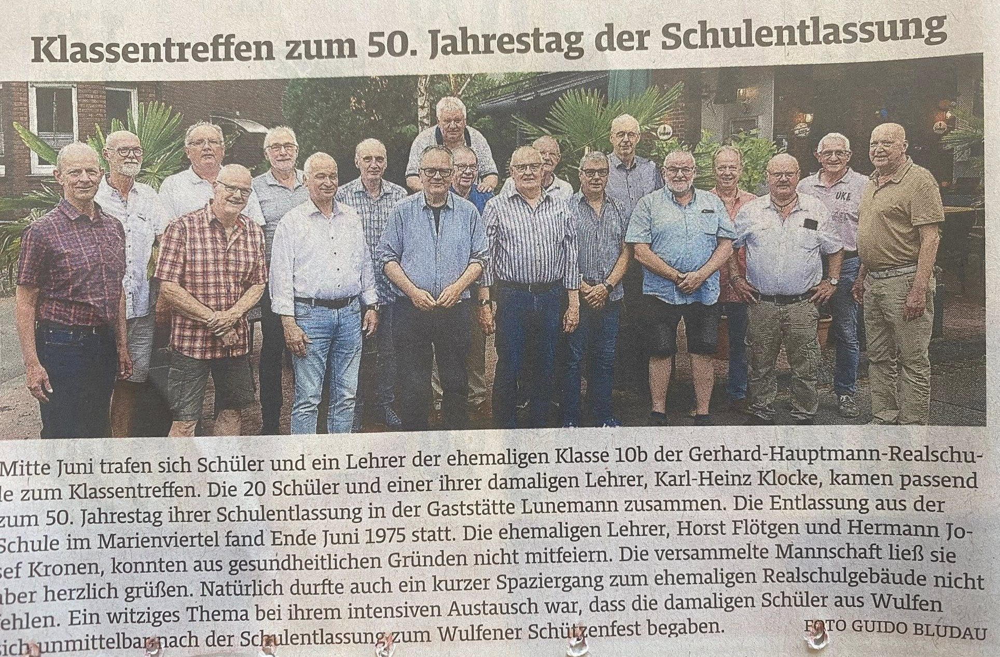
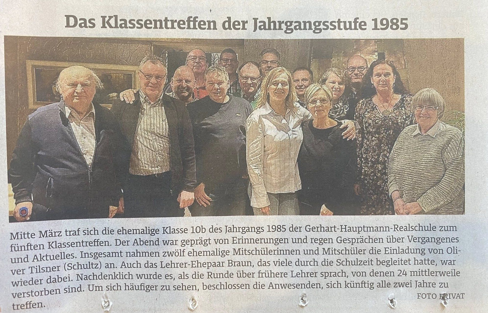

## 40 Jahre später – Wiedersehen der Klasse 10c (Abschlussjahrgang 1985)

Nicht nur die Klasse 10c traf sich in diesem Jahr zu einem besonderen Wiedersehen. Bereits im Juni 2025 hatte auch die **10b** (Entlassjahrgang 1975) Grund zu feiern: **50 Jahre nach ihrer Schulentlassung** kamen sie wieder zusammen – ein eindrucksvolles Zeichen dafür, wie stark die Verbundenheit ehemaliger GHS-Schülerinnen und -Schüler auch Jahrzehnte nach der Schulzeit noch ist.  
Und schon im **März 2025** traf sich die **10b** ebenfalls – diesmal der **Abschlussjahrgang 1985** – zu einem weiteren Klassentreffen.

---

### Jubiläumstreffen der Klasse 10b – 50 Jahre nach dem Abschluss

Im Juni 2025 trafen sich **20 ehemalige Schüler** der **Klasse 10b (Entlassjahrgang 1975)** gemeinsam mit ihrem damaligen Lehrer **Karl-Heinz Klocke** zu einem großen Jubiläumstreffen in der Gaststätte **Lunemann**.  

Die Entlassung aus der Gerhart-Hauptmann-Realschule im Marienviertel fand **Ende Juni 1975** statt. Die ehemaligen Lehrer **Horst Flötgen** und **Hermann Josef Kronen** konnten aus gesundheitlichen Gründen nicht teilnehmen, ließen jedoch herzliche Grüße ausrichten.  

Neben dem gemütlichen Beisammensein stand auch ein Spaziergang zum ehemaligen Schulgebäude auf dem Programm. Besonders nostalgisch wurde es beim Rückblick auf das legendäre **Wulfener Schützenfest**, zu dem sich viele der damaligen Schüler unmittelbar nach ihrer Schulentlassung aufgemacht hatten.

---

### Jubiläumstreffen der Klasse 10b – 40 Jahre nach dem Abschluss

Auch die **10b des Abschlussjahrgangs 1985** kam in diesem Jahr wieder zusammen. Im **März 2025** trafen sich ehemalige Schülerinnen und Schüler bereits zum **fünften Klassentreffen**, um gemeinsam auf Erinnerungen zurückzublicken und miteinander über Vergangenes und Aktuelles zu sprechen.  

Insgesamt folgten zwölf Ehemalige der Einladung – und auch das Lehrer-Ehepaar **Gerd und Henrike Braun**, das viele durch die Schulzeit begleitet hatte, war wieder dabei. Nachdenklich wurde es, als man über frühere Lehrer sprach, von denen mittlerweile **24 verstorben** sind. Am Ende des Abends beschlossen die Anwesenden, sich künftig **alle zwei Jahre** wiederzutreffen.

---

### 40 Jahre später – Wiedersehen der Klasse 10c

Am **28. Juni 2025** war es dann auch für die **10c** so weit:  
Die ehemalige Klasse traf sich nach **vier Jahrzehnten** erstmals wieder – ein besonderes Ereignis voller Emotionen, Erinnerungen und Geschichten, das bei **Hülsdünker** gefeiert wurde.

---

### Lehrer, Schüler – und ein Stück gemeinsame Geschichte

Von den damaligen Schülerinnen und Schülern waren **16 Ehemalige** gekommen. Besonders gefreut hat sich die Runde über den Besuch von gleich **drei Lehrkräften**, die eigens für diesen Anlass erschienen: **Gerd Braun**, **Henrike Braun** und **Claudia Mölken**.  

Dass sich Gerd Braun – inzwischen **85 Jahre alt** – noch einmal auf den Weg machte, freute alle ganz besonders. Gemeinsam mit seinen damaligen Kolleginnen **Henrike Braun** und **Claudia Mölken** war er sofort wieder „mittendrin“ im Klassentreffen – als wären seit der letzten gemeinsamen Schulzeit kaum Jahrzehnte vergangen.

---

### Anekdoten, Geständnisse und eine „Feuerbestattung“

Ein Höhepunkt des Abends war ein humorvolles Geständnis: Vor vielen Jahren war **Claudia Mölkens Lehrerkalender – inklusive aller Noten – in Schülerhände geraten**. Jahrzehnte später wurde das „Beweisstück“ feierlich **verbrannt** – eine symbolische *Feuerbestattung* mit viel Gelächter und einer großzügigen **Absolution** der ehemaligen Lehrerin.  

Der Abend war insgesamt geprägt von **kleinen und großen Erinnerungen**, von Geschichten, die man längst vergessen glaubte, und von der Erkenntnis, dass **gemeinsame Schulzeit ein Band ist, das Jahrzehnte überdauert.**

---

### Erinnerungen an Herrn Kronen

Auch **Herr Kronen** wurde nicht vergessen: Einige Tage vor dem Treffen suchten ehemalige Schüler ihn auf, um ihn persönlich einzuladen. Doch mit **98 Jahren**, eingeschränktem Seh- und Hörvermögen, fühlte er sich für ein solches Wiedersehen nicht mehr fit genug – ließ aber **herzliche Grüße** an seine frühere Klasse ausrichten.

---

### Ein Versprechen für die Zukunft

Am Ende des Abends waren sich alle einig: **Das nächste Wiedersehen wird nicht erst in weiteren 40 Jahren stattfinden.**  
Zu groß war die Freude, zu lebendig die Gespräche und zu stark das Gefühl, wieder „zurück in der alten Klasse“ zu sein.

---

📸 **Fotos vom Abend**

  

    
    
    
    
    
    
    
    
    
    
    
    
    
    
  

  <em>Gallery · Fotos: Detlev Stoffel</em>

