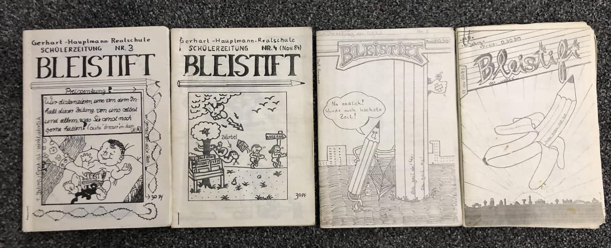

Olaf Grewer (Abschluss 1986) hat alte Ausgaben vom „Bleistift“ wiedergefunden, der Schülerzeitung der Gerhart-Hauptmann-Realschule.

<figure>
  
  <figcaption style="margin-top: 6px; font-size: 0.85em;">Nr. 3, Nr. 4 (November 1984), Nr. 5 und eine weitere Ausgabe. Foto: Olaf Grewer</figcaption>
</figure>

Jede Ausgabe kostete 30 Pfennig.

Hast Du beim „Bleistift“ mitgemacht, erinnerst Du Dich an einen Artikel oder hast Du selbst noch Ausgaben? Schreib uns über das [Kontaktformular](/kontakt/).
