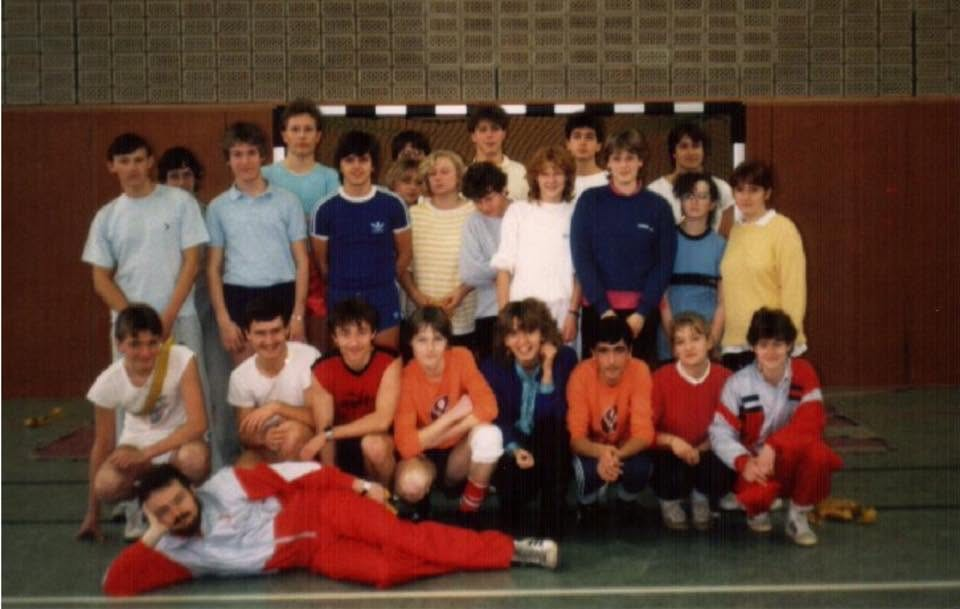
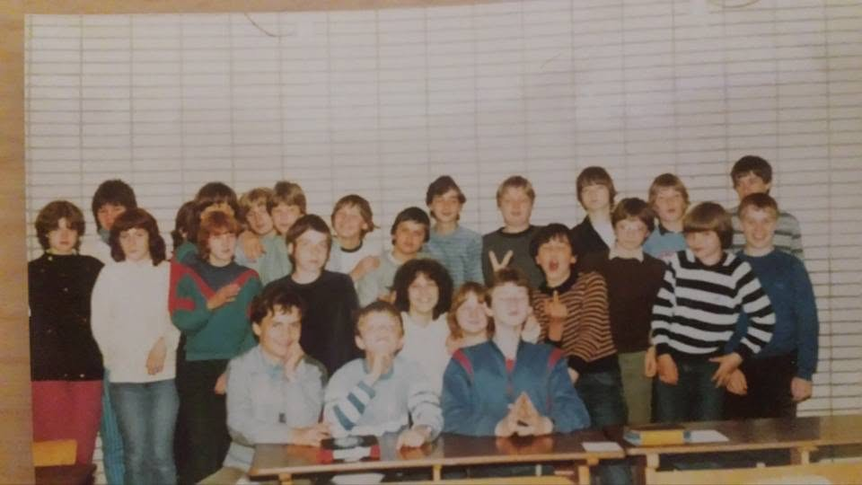

Die drei Fotos stammen von Volker Radmer und Kerstin Krenz. Auf der Wiese und in der Turnhalle ist großenteils dieselbe Klasse zu sehen. [Katja Neumann](/katja) (Link) erkennt darin ihre frühere Klasse, die b – mit Martina, Petra, Heike, Anke, Christian, Volker und den anderen.

Das Foto oben entstand auf der Wiese vor dem Neubau von 1972 mit dem Sprachlabor. Die rote Säule ist der große Bleistift, der dort stand; ganz zu sehen ist er auf dem [Foto des Neubaus](/geschichte/#neubau-1972) in der Schulgeschichte.

Vorne sitzen und knien von links Thorsten Badde, Oliver Albert, Michael Thust, Martina Heinrich und Christian Neuhaus. Hinten stehen von links Andreas Gandor, Robert Craddock und Hüseyn Davraz. Vor dem Bleistift steht Anke Ridderbusch, rechts hinter ihr Carsten Meichsner. Weiter rechts, hinter dem blonden Mädchen in der karierten Bluse, steht Volker Radmer, dann Sven Lüftner und ganz rechts Kai Adam.

<figure>
  
  <figcaption style="margin-top: 6px; font-size: 0.85em;">In der Turnhalle</figcaption>
</figure>

Vorne liegt der Sportlehrer [Gerd Sellheyer](/lehrer/sellheyer/).

Hinter ihm hocken von links Thorsten Badde, Michael Brünnig, Oliver Albert, Michael Thust, Martina Heinrich, Hüseyn Davraz, Bärbel Jauer und Nicola Lützner (Otte). Stehend von links: Carsten Meichsner (hinten im hellblauen T-Shirt), Astrid Regina Stappert (halb verdeckt, neben dem Jungen im blauen Adidas-Trikot), Petra Hosemann, Gaby Seifert (im weißen Pulli), Anke Ridderbusch (im dunkelblauen Pulli), mit Brille Astrid Brinkmann (Zuschlag) und Manuela Lidtke (im gelben Pulli). Hinter Astrid Brinkmann steht Robert Craddock.

Ob das Turnhallenfoto in unserer Großturnhalle entstand, wissen wir nicht sicher. Auf den Fotos von 2024 im Beitrag [Abschied von der Turnhalle](/blog/turnhalle) sehen die Wände anders aus: weiße Steine und helle Paneele statt gelochter Steine und brauner Holzverkleidung.

<figure>
  
  <figcaption style="margin-top: 6px; font-size: 0.85em;">Im Klassenraum</figcaption>
</figure>

Erkennst Du Dich oder Deine Mitschüler, auch auf dem Foto im Klassenraum? Weißt Du, in welchem Jahr diese Klasse ihren Abschluss gemacht hat, in welchem Schuljahr die Fotos entstanden sind, welche Klasse im Klassenraum zu sehen ist und wo das Turnhallenfoto entstand? Schreib uns über das [Kontaktformular](/kontakt/).
